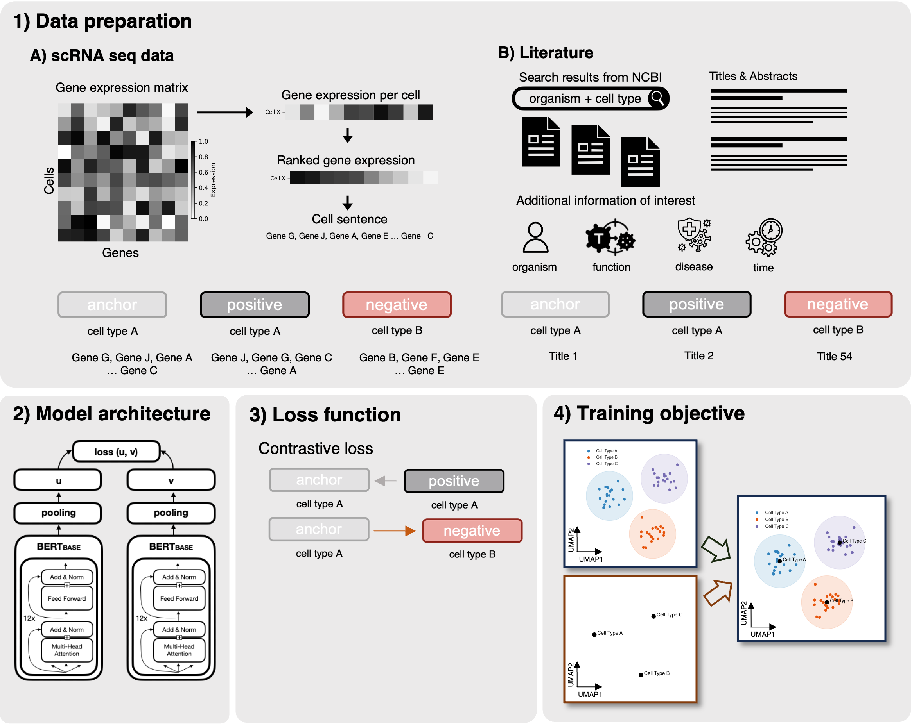

# Adding layers of information to scRNA-seq data using pre-trained language models

[](https://github.com/MariaKrissmer/alias/actions/workflows/test.yml)
[](https://www.python.org/downloads/)

This is a first version of the codebase corresponding to our PrePrint [(bioRxiv)](https://www.biorxiv.org/content/10.1101/2025.08.23.671699v1), where we show how small encoder-only language models can be used to generate a joint embedding space for scRNA-seq data with corresponding biomedical literature.



This branch contains the public reproducibility workflows for the manuscript's selected ALIAS models. It covers the HIAI T-cell ablation models (`MA`, `MA*`, `MB`, `MC`, `MC*`, and `MD`), the HIAI CMV-oriented literature model (`ME`), the LaManno donor/sample and timepoint generalization models (`MF` and `MG`), and the PubMedBERT baseline.


## Setup

```bash
# Clone the repository
git clone <repo-url>
cd alias

# Install dependencies using uv
uv sync --extra annotation --extra evaluation

# Set up your Hugging Face tokens
cp .env.example .env
# Edit .env and add your actual Hugging Face tokens
```

### Environment Variables

The project requires Hugging Face tokens for accessing and uploading models/datasets, if own models are trained and saved. The manuscript models are currently are available on Hugging Face; their repository links are listed below.

**Quick setup:**
```bash
cp .env.example .env
# Edit .env and add your actual Hugging Face tokens
```

📖 **For detailed configuration instructions, troubleshooting, and usage examples, see [CONFIGURATION.md](CONFIGURATION.md)**

## Reproducibility inputs and outputs

Raw HIAI and LaManno data, generated datasets, model checkpoints, logs, credentials, and evaluation outputs are intentionally not tracked. Place the source `.h5ad` files under the project-local `out/` layout described by the scripts, and provide Hugging Face access through `.env` when using the published datasets or models.

The tracked provenance files are under [`reproducibility/`](reproducibility/):

- `manifests/model_registry.yaml` maps manuscript labels to canonical model IDs and public Hugging Face model repositories.
- `manifests/dataset_registry.yaml` maps dataset IDs to generation scripts and metadata.
- `manifests/query_manifest.csv` contains the NCBI query strings.
- `manifests/pmid_manifest.csv` contains the PMIDs used by the literature workflows.
- `manifests/ncbi_raw_pmid_manifest.csv` contains the PMID-only raw NCBI retrieval record before dataset-specific filtering.
- `manifests/split_manifest.json` contains the deterministic split indices and seeds.
- `metadata/` contains sanitized dataset and model metadata without machine-specific paths.
- `metadata/datasets/HIAI_Tcells/CL_raw_collection/` contains the raw Cell Ontology/scType term records used for the HIAI CL-infused literature cell sentences. The LaManno `N5` literature dataset was generated without CL term infusion, so no LaManno CL term summary is included.

A full [Figure 2 reproducibility notebook](notebooks/figure2.ipynb) is available as a worked example for the computational panels (A, C, D, and E), using the test data in `out/data/`.

## Selected HIAI workflows

The commands below are the selected public HIAI workflows. They are intentionally explicit about canonical IDs; manuscript labels are used only in the registry and presentation tables.

### Generate datasets

```bash
uv run python scripts/revision1_v1/HIAI_Tcells/dataset_generation/generate_N1_N3_ncbi_literature.py
uv run python scripts/revision1_v1/HIAI_Tcells/dataset_generation/generate_N4_ncbi_literature_cmv.py
uv run python scripts/revision1_v1/HIAI_Tcells/dataset_generation/generate_S2_heldout_donor_semantic_200k.py
uv run python scripts/revision1_v1/HIAI_Tcells/dataset_generation/generate_S3_heldout_donor_nonsemantic_200k.py
uv run python scripts/revision1_v1/HIAI_Tcells/dataset_generation/generate_S5_heldout_donor_semantic_shuffled_labels_200k.py
uv run python scripts/revision1_v1/HIAI_Tcells/dataset_generation/generate_S7_heldout_donor_semantic_cmv_200k.py
```

The NCBI scripts generate the N1 literature dataset, the N3 shuffled-literature control used in the ablation study, and the N4 CMV-oriented literature dataset.

### Train models

```bash
uv run python scripts/revision1_v1/HIAI_Tcells/train_models/train_MB_S2_N1_200k_lr5e5.py
uv run python scripts/revision1_v1/HIAI_Tcells/train_models/train_MJ_S2_N3_200k_lr5e5.py
uv run python scripts/revision1_v1/HIAI_Tcells/train_models/train_MG_S2_200k_lr5e5.py
uv run python scripts/revision1_v1/HIAI_Tcells/train_models/train_MF_S3_200k_lr5e5.py
uv run python scripts/revision1_v1/HIAI_Tcells/train_models/train_MH_S5_200k_lr5e5.py
uv run python scripts/revision1_v1/HIAI_Tcells/train_models/train_MI_N1_200k_lr5e5.py
uv run python scripts/revision1_v1/HIAI_Tcells/train_models/train_MM_S2_N4_200k_lr5e5.py
```

### Evaluate models

Run cell-type annotation with the selected ablation models:

```bash
uv run python scripts/revision1_v1/HIAI_Tcells/celltype_annotation/run_celltype_annotation.py \
  --models Base,MI,MF,MG,MB,MJ,MH
```

The CMV functionality assessment is implemented in [`run_functionality_downstream_disease_comparison.py`](scripts/revision1_v1/HIAI_Tcells/functionality_assessment/run_functionality_downstream_disease_comparison.py). It evaluates the public `ALIAS-MA` and `ALIAS-ME` models on the S7 test data.

### External embedding benchmarks for Figure 2E

The scGPT embeddings were generated without fine-tuning using [`generate_scgpt_embeddings.py`](src/alias/evaluation/embedding_evaluation/generate_scgpt_embeddings.py). The scVI Census embeddings were generated with [`generate_scvi_census_embeddings.py`](src/alias/evaluation/embedding_evaluation/generate_scvi_census_embeddings.py) in pretrained and dataset-adapted modes. The adapted run was configured for 20 training epochs with early stopping. The three saved embedding files and their generation metadata are under `out/data/revision1_v1/HIAI_Tcells/S2_heldout_donor_semantic_200k/embeddings_evaluation/external_embeddings/`; available reference model files are under `out/models/`. Figure 2 uses the saved embeddings as benchmark inputs. The adapted scVI checkpoint was not retained, so its saved embedding file is the exact input for that comparison.

## Selected LaManno workflows

The LaManno workflows reproduce the held-out donor/sample and held-out timepoint models. `N5` uses NCBI literature only; CL term summaries are not included for this dataset.

### Generate datasets

```bash
uv run python scripts/revision1_v1/LaManno/dataset_generation/generate_N5_ncbi_literature.py
uv run python scripts/revision1_v1/LaManno/dataset_generation/generate_S9_heldout_sample_semantic.py
uv run python scripts/revision1_v1/LaManno/dataset_generation/generate_S10_heldout_timepoint_semantic.py
```

### Train models

```bash
uv run python scripts/revision1_v1/LaManno/train_models/train_MO_S9_N5_lr5e5.py
uv run python scripts/revision1_v1/LaManno/train_models/train_MP_S10_N5_lr5e5.py
```

### Evaluate models

The LaManno evaluation scripts are [`run_lamanno_embedding_evaluation.py`](scripts/revision1_v1/LaManno/evaluation/run_lamanno_embedding_evaluation.py) for the S9 developmental analysis with `ALIAS-MF` and [`heldout_timepoint_eval.py`](scripts/revision1_v1/LaManno/evaluation/heldout_timepoint_eval.py) for the S10 held-out-timepoint analysis with `ALIAS-MG`.

## PBMC3k sentence-length sensitivity analysis (Figure S1B)

The supplementary PBMC3k analysis uses five cell sentence lengths (10, 20, 50, 100, 200) and three training seeds (73, 101, 202). To reproduce it in a fresh local directory:

```bash
export PBMC3K_STUDY_ROOT="$PWD/out/data/revision1_v1/pbmc3k_reproduction"
export PBMC3K_MODEL_ROOT="$PBMC3K_STUDY_ROOT/models"
uv run --extra evaluation python scripts/revision1_v1/pbmc3k/run_cell_sentence_length_stability.py --stage generate
uv run --extra evaluation python scripts/revision1_v1/pbmc3k/run_cell_sentence_length_stability.py --stage train
uv run --extra evaluation python scripts/revision1_v1/pbmc3k/evaluate_cell_sentence_length_stability.py
```

Training saves the 15 models locally and does not upload them. Evaluation loads those local weights, generates embeddings in a new `analysis_runs/cell_sentence_length_stability/` folder, and saves label-alignment and scIB biological-conservation results there. The scripts also accept `--cs-length` and `--training-seed` to run a single model. The original training configuration uses 10 epochs.

To evaluate existing local data and models without generation or training, set `PBMC3K_STUDY_ROOT` and `PBMC3K_MODEL_ROOT` as above and run only `evaluate_cell_sentence_length_stability.py`. Use `--cs-length` and `--training-seed` to select a subset; the full comparison uses all 15 trained models.

## Selected models

The ALIAS model repositories below are public.

| Manuscript label | Description | Canonical model | Hugging Face |
|---|---|---|---|
| `MA` | HIAI donor-generalization ablation | `MB` | [ALIAS-MA](https://huggingface.co/mariakrissmer/ALIAS-MA) |
| `MA*` | HIAI shuffled-literature control | `MJ` | [ALIAS-MA-star](https://huggingface.co/mariakrissmer/ALIAS-MA-star) |
| `MB` | HIAI metadata contribution | `MG` | [ALIAS-MB](https://huggingface.co/mariakrissmer/ALIAS-MB) |
| `MC` | HIAI non-semantic ablation | `MF` | [ALIAS-MC](https://huggingface.co/mariakrissmer/ALIAS-MC) |
| `MC*` | HIAI shuffled-label control | `MH` | [ALIAS-MC-star](https://huggingface.co/mariakrissmer/ALIAS-MC-star) |
| `MD` | HIAI literature-only model | `MI` | [ALIAS-MD](https://huggingface.co/mariakrissmer/ALIAS-MD) |
| `ME` | HIAI CMV-oriented literature model | `MM` | [ALIAS-ME](https://huggingface.co/mariakrissmer/ALIAS-ME) |
| `MF` | LaManno donor/sample generalization | `MO` | [ALIAS-MF](https://huggingface.co/mariakrissmer/ALIAS-MF) |
| `MG` | LaManno timepoint generalization | `MP` | [ALIAS-MG](https://huggingface.co/mariakrissmer/ALIAS-MG) |
| `Base` | PubMedBERT baseline | `neuml/pubmedbert-base-embeddings` | [model page](https://huggingface.co/neuml/pubmedbert-base-embeddings) |

## Getting Started

### Demo Notebook

Check out the complete training pipeline in our demo notebook:

```bash
# Place your demo data at data/demo.h5ad
# Then run the notebook
uv run jupyter notebook notebooks/demo_training_pipeline.ipynb
```

See [`notebooks/README.md`](notebooks/README.md) for more details.

## Testing

The package is tested on Python 3.11, 3.12, and 3.13.

### Test Suite

- **Import tests** - Verify all modules can be imported
- **Config validation** - Test configuration classes and defaults
- **Dependency integration** - Ensure package dependencies work together

To run tests locally:

```bash
# Run all tests (67 tests, ~3 seconds)
uv run pytest tests/ -v

# Run fast unit tests only (63 tests, ~2 seconds)
uv run pytest tests/ -v -m "not integration"

# Run integration tests with real data (4 tests)
uv run pytest tests/ -v -m integration

# Run specific test files
uv run pytest tests/test_imports.py -v
uv run pytest tests/test_configs.py -v
uv run pytest tests/test_integration_pipeline.py -v
```

Tests run automatically on every push via GitHub Actions. See [`tests/README.md`](tests/README.md) for details. 


